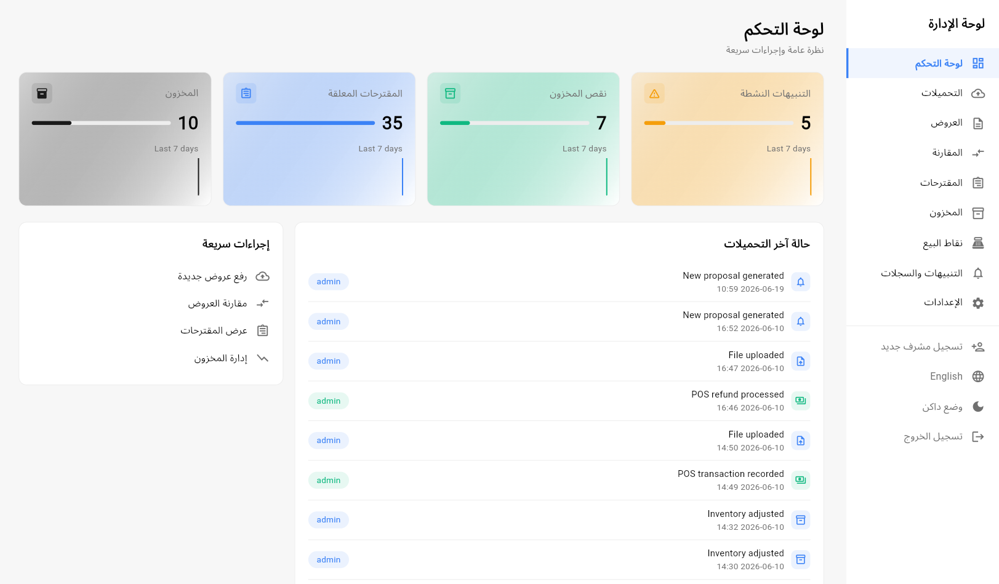
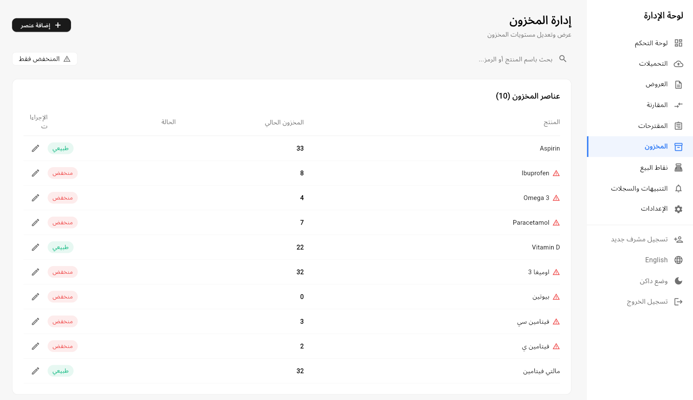
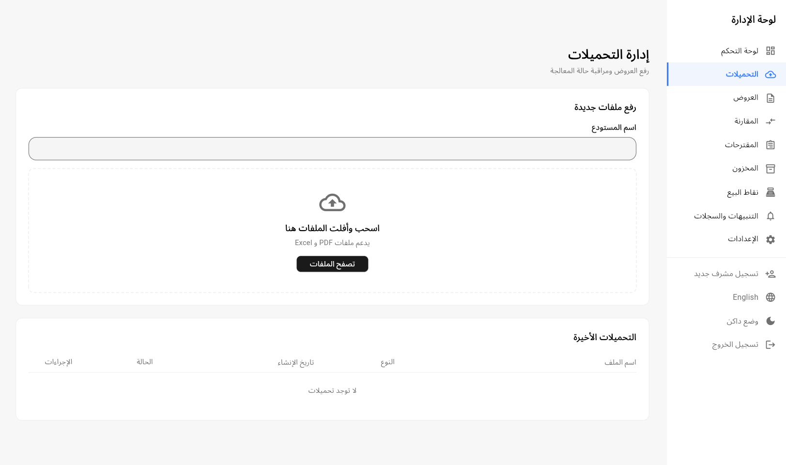
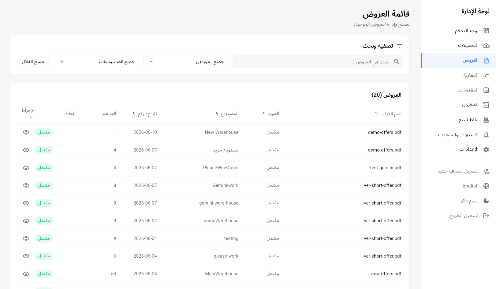
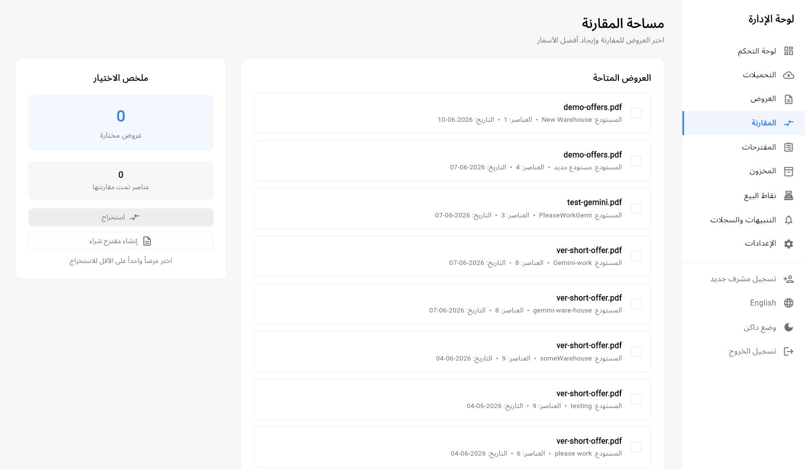
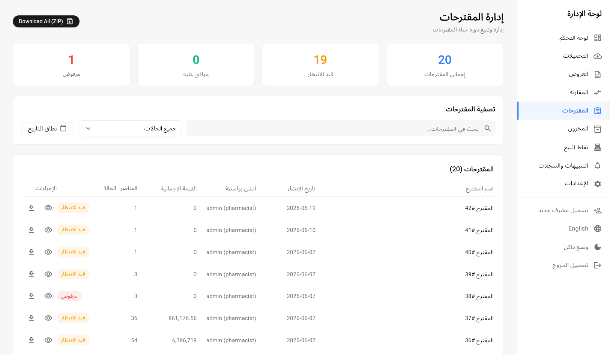
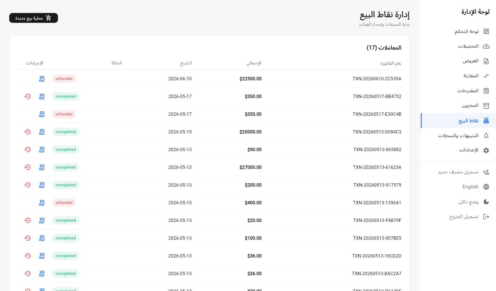

# Pharmacio

**A smart pharmacy management system for the day-to-day work of a pharmacy.**

Pharmacio brings inventory, supplier offers, purchasing, point of sale, and document processing into one platform. Pharmacy teams can keep track of medicine stock, spot low-stock items, compare supplier offers, prepare purchase proposals, and record sales from web and mobile applications. The interface supports Arabic and English.

## What Pharmacio helps with

- **Inventory management:** Track medicines and quantities, update stock, and surface low-stock alerts.
- **Supplier offers:** Upload offer documents, review extracted line items, and compare offers to find suitable prices.
- **Purchasing workflow:** Create purchase proposals from selected items and follow their approval status.
- **Point of sale:** Record transactions, issue receipts, and handle refunds.
- **Document processing:** Send PDF and image uploads through an asynchronous OCR workflow to extract structured offer data.
- **Pharmacy operations:** Use role-based access, notifications, and audit records to support controlled day-to-day work.

## How it works

1. A pharmacy team uploads an offer as a PDF or image, or imports an opening inventory balance from a spreadsheet.
2. The backend stores the file and routes supported offer documents to the configured OCR service as a background job, so processing does not block the main application.
3. The OCR service fetches the document, converts PDF pages to images, detects table regions, and extracts Arabic or English text into structured rows.
4. The service sends its results back to the backend. Staff can review offers, compare their items, and prepare purchase proposals.
5. Inventory alerts, proposal statuses, sales, receipts, and refunds are managed through the pharmacy application.

## Screenshots

<table>
  <tr>
    <td align="center" width="50%">
      
       <strong>Operations dashboard</strong>
    </td>
    <td align="center" width="50%">
      
       <strong>Inventory and low-stock alerts</strong>
    </td>
  </tr>
  <tr>
    <td align="center" width="50%">
      
       <strong>Document intake</strong>
    </td>
    <td align="center" width="50%">
      
       <strong>Offer review</strong>
    </td>
  </tr>
  <tr>
    <td align="center" width="50%">
      
       <strong>Offer comparison</strong>
    </td>
    <td align="center" width="50%">
      
       <strong>Purchase proposals</strong>
    </td>
  </tr>
  <tr>
    <td align="center" width="50%">
      
       <strong>Point of sale</strong>
    </td>
    <td width="50%"></td>
  </tr>
</table>

## Technologies

| Area | Technologies |
|---|---|
| Web and mobile apps | Flutter, Dart |
| Backend and API | Python, Django, Django REST Framework |
| Database and background work | PostgreSQL, Redis, Celery |
| OCR service | Python, FastAPI, Uvicorn, OpenCV, EasyOCR, Pandas, `pdf2image` |
| File storage and deployment | S3-compatible storage, Boto3, Docker Compose |

## Run the project

The applications and services have separate setup requirements and configuration. Start with the guide for the component you want to run:

- [Backend and API](backend/README.md)
- [Web application](web/README.md)
- [Mobile application](mobile/README.md)
- [OCR service](services/ocr/README.md)
- [AI service](services/ai/README.md)

To run the integrated system, configure the backend and the selected OCR service with matching service URLs and credentials. Use the example environment files as templates; do not commit real credentials.
